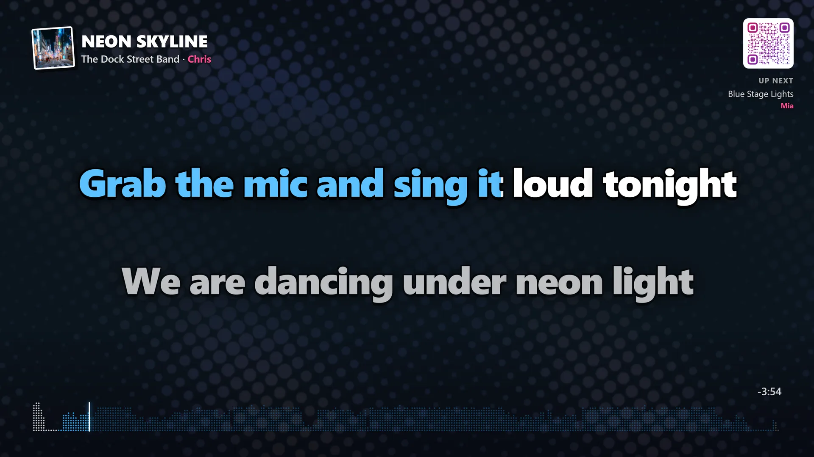
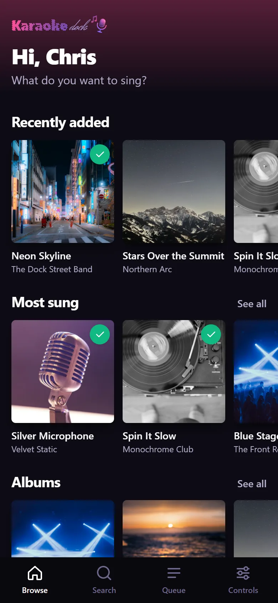
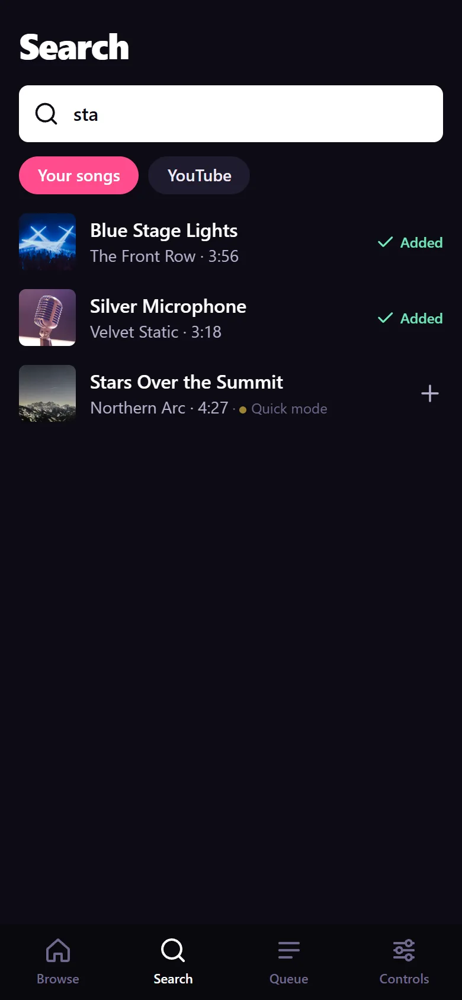
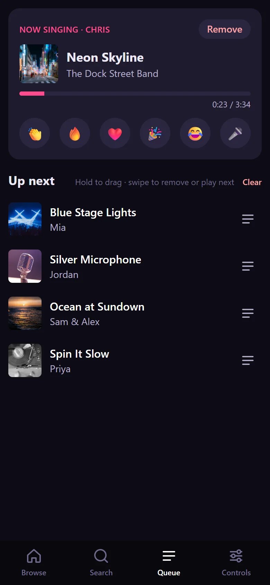
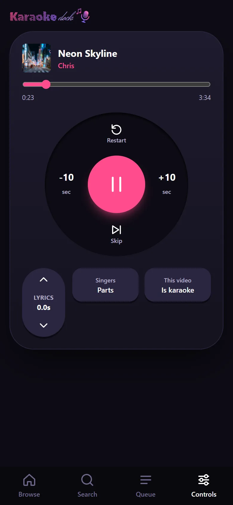
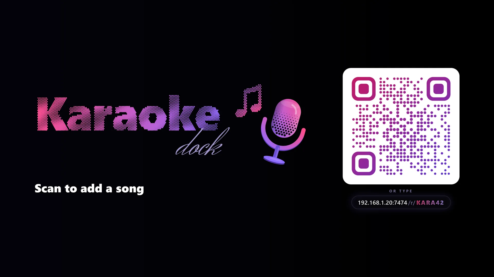
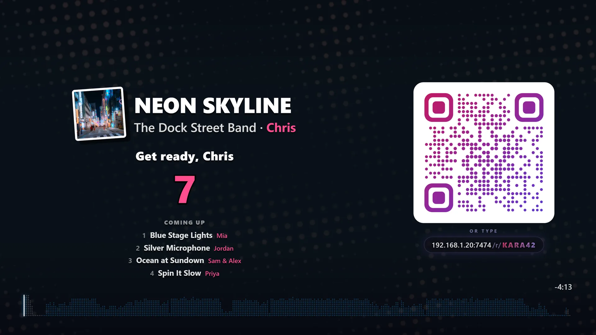
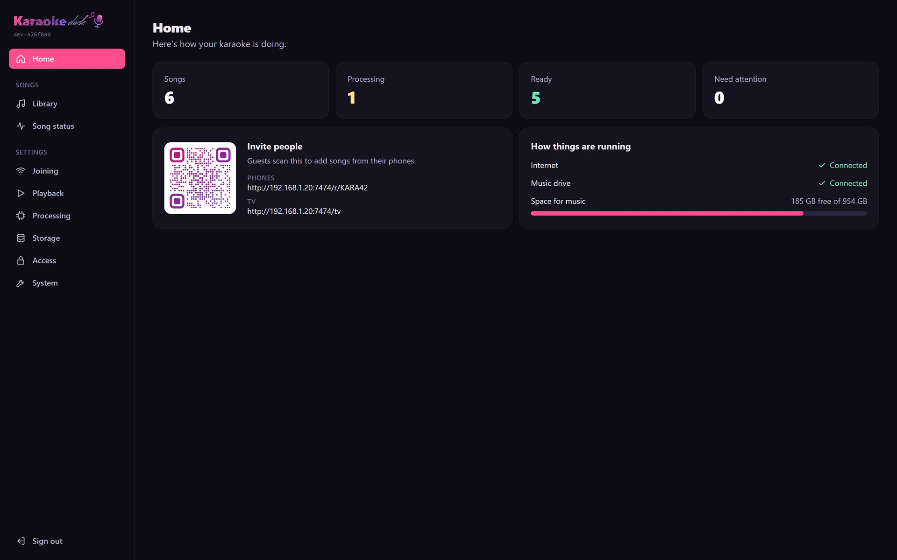
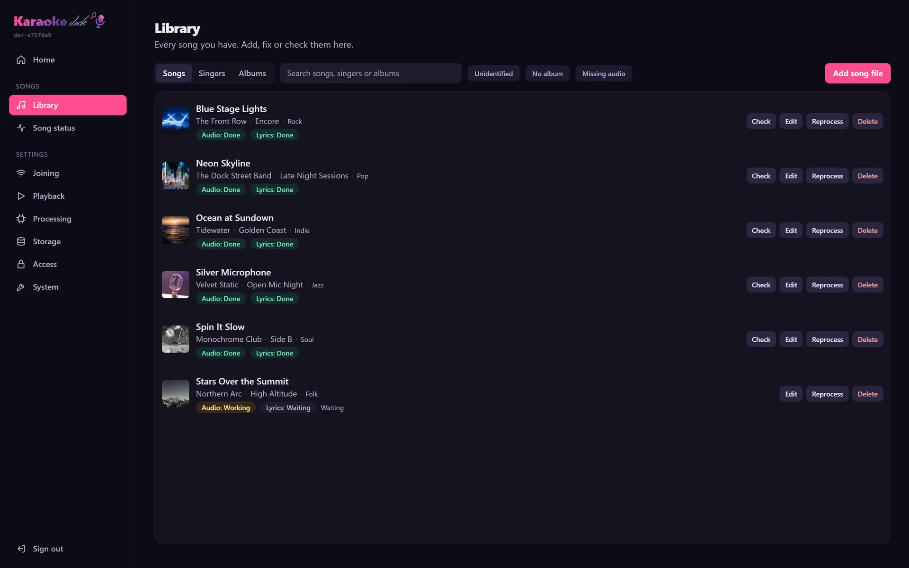

# KaraokeDock

> **Status:** Beta · Licensed under [GNU AGPL-3.0](LICENSE)

Self-hosted karaoke for a home network. One machine prepares and serves the songs, a TV browser (or Android TV app) shows the lyrics, and guests scan a QR code or use the Android phone app to queue songs.

Once a song is prepared, it plays without internet.



<p align="center">
  
  
  
  
</p>

## What it does

- Finds songs on YouTube, or takes a pasted link, and keeps only the audio and lyrics
- Removes the vocals when a track has them, and skips that step for karaoke tracks
- Gets lyrics from LRCLIB and song details from MusicBrainz
- Times the lyrics from the colour wipe in karaoke videos, or from the singing with Whisper
- Lets guests add, remove and search songs from their phones
- Gives the host a remote on the phone, with an optional PIN
- Works with the TV's own remote: OK pauses, left and right jump 10 seconds, and play, pause, stop and next buttons work where the TV sends them
- Clears a forgotten queue after a few hours, so the next party starts fresh
- Has an admin page for settings, storage, the library and processing status

## Quick Install (Releases)

- **Windows:** Download `KaraokeDock-Setup.exe` from [Releases](https://github.com/geejayjay/karaoke-dock/releases) and run it. The installer downloads what preparing songs needs (FFmpeg, yt-dlp, Deno, Python, the AI libraries and models, about 1.8 GB on disk), so the app is ready when it finishes. Launching **KaraokeDock** starts the server in the system tray and opens **Admin**. If setup is ever interrupted, `bin\karaokedock.exe setup` in the install folder finishes it, and the app also fills in anything missing when it starts.
- **Proxmox LXC / Debian / Ubuntu / Raspberry Pi (64-bit):**
  ```bash
  curl -fsSL https://github.com/geejayjay/karaoke-dock/releases/latest/download/install-linux.sh | sudo bash
  ```
- **Docker (`amd64` & `arm64`):** see [Docker](#docker) below.
- **Android Phone & Android TV Apps:** Download `karaokedock-mobile.apk` and `karaokedock-tv.apk` from Releases (they auto-discover your KaraokeDock server over Wi-Fi, with manual IP fallback).

## Docker

```bash
docker pull ghcr.io/geejayjay/karaoke-dock:latest
```

```bash
docker run -d --name karaokedock --restart unless-stopped -p 7464:7464 -v ./data:/data ghcr.io/geejayjay/karaoke-dock:latest
```

Or, from this folder, `docker compose up -d` does the same with the included `docker-compose.yml`.

The image includes everything, AI models too, so a new container starts ready. Songs, the database and settings are kept in `./data`. On Linux or a Raspberry Pi, `network_mode: host` lets the QR code find the machine's real network address. With Docker Desktop on Windows or Mac, keep the port mapping and set the network address in Admin, under Joining.

## Screens

The TV waits with a QR code until someone adds a song:



Between songs, a countdown tells the next singer to get ready and shows who's coming up:



Admin shows what's ready, what's being prepared and how to invite people:





## Build from Source

Requirements:

- Windows or Linux
- [Go](https://go.dev), at the version in `server/go.mod`
- [Node.js](https://nodejs.org) and [pnpm](https://pnpm.io)
- [uv](https://docs.astral.sh/uv/), which installs its own Python 3.12
- [FFmpeg](https://ffmpeg.org)
- [yt-dlp](https://github.com/yt-dlp/yt-dlp) and [Deno](https://deno.com)

A graphics card is optional. AI work runs on the CPU by default.

## Install

Windows:

```powershell
powershell -ExecutionPolicy Bypass -File scripts\setup.ps1
```

Linux:

```bash
scripts/setup.sh
```

This installs the Python libraries, downloads the AI models and builds the app. It needs internet and takes a while the first time.

For an Nvidia card, use `-Profile cuda` on Windows or `scripts/setup.sh cuda` on Linux. Reading lyrics from the video only works with the default CPU install.

To add the optional duet lyrics, use `-WithDuetLyrics` on Windows or `--with-duet-lyrics` on Linux.

## Run

Windows:

```powershell
scripts\start.ps1
```

Linux:

```bash
scripts/start.sh
```

Then open these, replacing `<server>` with the address printed at startup:

| Page | Address |
|---|---|
| TV | `http://<server>:7464/tv` |
| Admin | `http://<server>:7464/admin` |
| Phone | Scan the QR code on the TV |

The first time you open Admin, it asks you to create a password. Do this before guests join, since anyone on the network could create it first.

If you forget the password, run this from the project folder, then open Admin to create a new one:

```bash
bin/karaokedock admin reset-password
```

On Windows the program is `bin\karaokedock.exe`.

Options: `-port`, `-bind`, `-metadata` and `-sidecar`. The default port is 7464, which spells SING on a phone keypad. `KARAOKEDOCK_PORT` also sets it.

To use your own font for "dock" in the name, save it as `data/metadata/fonts/script.otf`. Without it, a built-in script font is used.

## Development

On Windows, double-click `dev.bat`, or run it from a terminal. It closes any running copy, rebuilds what changed and starts the app.

For live page reloads, keep the app running and start Vite as well:

```bash
cd web
pnpm dev
```

Admin and the TV work through Vite at `/admin.html` and `/tv.html`. The phone page needs the real server for now, because Vite doesn't handle `/r/<room>`.

To try the app with a demo library (six made-up songs with placeholder audio and lyrics, and a queue), without touching your own songs:

```bash
go -C server run ./cmd/demo -data ../data-demo
bin/karaokedock -metadata data-demo/metadata
```

The demo's room code is `KARA42` and its Admin password is `demo-password`. Covers are optional: put square JPEGs named after each song (for example `neon-skyline.jpg`) in `server/cmd/demo/covers/`, which git ignores. To make the TV's background and song bar move like a real song, add `-visual` with the `visual.json` of a song you've prepared, from `data/metadata/songs/<id>/`. The screenshots in this README come from the demo, with free photos from [Unsplash](https://unsplash.com/license) as covers.

Tests:

```bash
cd server && go test ./...
cd sidecar && uv run --no-sync pytest -q
cd web && pnpm test
```

## Project layout

| Folder | What's in it |
|---|---|
| `server` | Go backend, Windows tray host, job queue and SQLite database code |
| `sidecar` | Python helper for vocal removal, lyric timing and reading text from video |
| `web` | Shared Vue UI for the TV, phone and admin |
| `clients` | Capacitor Android wrappers (`mobile` and `tv`) sharing the `web` UI |
| `deploy` | Linux LXC/Pi installer, systemd service, Docker entrypoint and Windows installer |
| `scripts` | Local developer setup and start scripts |
| `data` | Songs, database and models, created at runtime and not committed |

## Limits

- Internet is needed for setup, YouTube downloads and lyric lookups.
- It's built for one room on a local network. It isn't meant to be exposed to the internet.
- Phones connect over plain `http`, so they can't use the microphone, and adding the page to a home screen only makes a shortcut.
- YouTube sometimes blocks downloads with a bot check, and those songs can't be added until it clears.
- Only download what you have the right to use.
